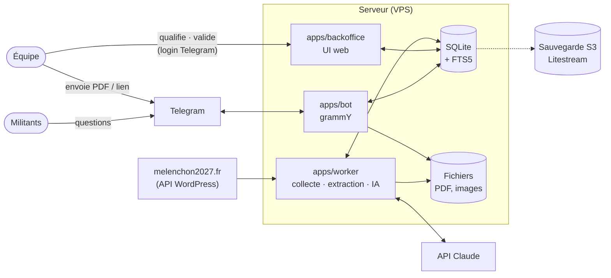

# Architecture cible — AECBot

> **Statut** : vision cible, rédigée en octobre 2026. Le code actuel (`pipeline/`, Python) ne couvre
> qu'une partie de l'étape 1 ; il sert de point de départ et de référence pendant le portage en
> TypeScript.
>
> **Cadre** : initiative personnelle, **non officielle**, non endossée par La France insoumise. Le bot
> doit l'indiquer clairement aux militants.


## En deux minutes (pour tout le monde)

Le projet est une **bibliothèque vérifiée** autour du programme « L'Avenir en commun », que les
militants interrogent depuis Telegram, l'outil qu'ils utilisent déjà.

1. **Rassembler** : les documents arrivent automatiquement depuis le site officiel, ou sont envoyés
   par l'équipe au bot Telegram (un PDF, un lien, un texte).
2. **Étiqueter** : chaque document reçoit des étiquettes (thème, type, date, source…). L'IA propose,
   un membre de l'équipe vérifie et corrige. La correction humaine a toujours le dernier mot.
3. **Rédiger** : à partir des documents vérifiés, l'IA prépare des fiches thématiques, des
   argumentaires et des réponses aux objections. Un membre de l'équipe les relit et les valide.
4. **Répondre** : un militant pose une question au bot, qui lui renvoie les documents les plus
   utiles, toujours avec leur source.

Trois garde-fous :
- rien de ce qu'écrit l'IA n'arrive à un militant sans relecture humaine ;
- chaque réponse cite sa source (titre, lien, page) ;
- un document qui ne vient pas d'une source officielle n'est diffusé qu'après vérification humaine.

---

## Principes de conception

| Principe | Conséquence |
|---|---|
| **Un seul modèle de document** | Documents collectés et documents générés vivent dans la même base. « Corpus qualifié » et « corpus publiable » sont des filtres, pas deux systèmes. |
| **L'humain a le dernier mot** | Chaque champ sait qui l'a rempli (IA ou humain). Une correction humaine est verrouillée : l'IA ne l'écrase jamais, même en relançant la qualification. |
| **La confiance vient de la source** | Une source `officielle` (WordPress LFI) peut être diffusée après qualification par l'IA seule. Les autres sources exigent une vérification humaine. |
| **Traçabilité** | Tout document généré liste les documents sources sur lesquels il s'appuie. Toute réponse du bot cite sa source. |
| **Au plus simple** | Un serveur, un fichier SQLite, des fichiers sur disque. Pas de Redis, pas de file de messages, pas de base vectorielle tant que ce n'est pas nécessaire. |
| **Full TypeScript** | Un monorepo, un modèle partagé entre bot, back-office et worker. |

## Modèle de données

```
Source        id, nom, url, confiance (officielle | vérifiée | non_vérifiée)

Document      id, origine (wp | push | généré), source_id, titre,
              texte (extrait, cherchable), fichier (chemin, optionnel),
              statut, créé_le, créé_par

Champ         document_id, clé, valeur,
              auteur (ia | humain), auteur_id, verrouillé, maj_le

Tag           document_id, tag, auteur (ia | humain)          -- tags libres

Filiation     document_généré_id → document_source_id         -- sources d'un doc généré

Utilisateur   telegram_id, nom, rôle (équipe | admin)          -- l'équipe uniquement

Job           id, type, payload, statut, tentatives, erreur   -- file de travail du worker
```

### Statuts

```
Document collecté :  reçu ──► qualifié_ia ──► qualifié (relu par un humain)
Document généré   :  brouillon ──► validé
                               └─► rejeté
```

### Properties obligatoires

| Clé | Valeurs | Pourquoi |
|---|---|---|
| `type_media` | `pdf`, `page`, `texte`, `image` (vidéo/audio plus tard) | Demandé : base de la classification. |
| `source` | référence vers une `Source` | Porte le niveau de confiance. |
| `url_origine` | URL, ou « push par <membre> » | Citation systématique. |
| `date_publication` | date | ≠ date de modification WordPress, qui n'est **pas** une date de rédaction ou d'adoption. |
| `corpus` | `aec_2027`, `aec_2022`, `nfp_2024`, `autre` | Ne jamais mélanger des programmes différents (le contrat NFP 2024 n'est pas l'AEC). |
| `validité` | `en_vigueur`, `remplacé`, `archive` | Le programme 2027 est provisoire : une nouvelle édition doit pouvoir déclasser l'ancienne. |
| `thèmes` | liste **fermée** (chapitres de l'AEC) | Colonne vertébrale de la recherche. Les tags libres viennent en plus. |

**Pour les documents générés uniquement** : `type_généré` (`fiche`, `argumentaire`,
`réponse_objection`), au moins une `Filiation`, `validé_par`, `validé_le`.

**Facultatives** : tags libres, `public` (`militant` / `grand_public`), `résumé` (généré par l'IA,
utilisé par le bot pour présenter un résultat).

### Règle de diffusion

C'est la règle centrale du projet. Elle vit à un seul endroit (`packages/core`), et le bot ne
contourne jamais ce filtre.

```ts
function estRenvoyable(doc: Document, source: Source): boolean {
  if (doc.origine === "généré") return doc.statut === "validé";
  if (doc.statut === "qualifié") return true;
  return doc.statut === "qualifié_ia" && source.confiance === "officielle";
}
```

## Composants



| Composant | Rôle |
|---|---|
| `packages/core` | Modèle de données (schéma Drizzle), règle `estRenvoyable`, règle de verrouillage des champs, accès DB. Importé par les trois apps. |
| `apps/worker` | Exécute les jobs : collecte WordPress, extraction de texte (PDF), qualification IA, génération IA. Tourne en continu et dépile la table `Job`. |
| `apps/backoffice` | UI web de l'équipe : file des documents à qualifier, édition et verrouillage des champs et tags, relecture et validation des documents générés, gestion des sources. Login via « Login with Telegram ». |
| `apps/bot` | Bot Telegram. Militants : question → recherche → documents renvoyables, avec source et avertissement « initiative non officielle ». Équipe (identifiée par `telegram_id`) : envoi d'un PDF ou d'un lien → document `reçu` + job d'extraction. |

## Flux principaux

**Collecte WordPress** (job planifié) : appel API `/pages`, `/posts`, `/media` → comparaison par
`id` + date de modification (logique actuelle de `check_updates.py`) → nouveaux documents `reçu`,
source `officielle` → job d'extraction → job de qualification.

**Push par l'équipe** : un membre envoie un fichier ou un lien au bot → document `reçu`, source
choisie ou `non_vérifiée` par défaut → mêmes jobs d'extraction et de qualification.

**Qualification** : l'IA (petit modèle, type Claude Haiku) lit le texte et propose les properties
obligatoires, les thèmes et des tags libres → `qualifié_ia`. Un humain relit dans le back-office ;
chaque champ qu'il touche devient `auteur = humain, verrouillé = true` → `qualifié`. Une
re-qualification IA ne modifie que les champs non verrouillés.

**Génération** : un membre demande « une fiche sur <thème> » ou « une réponse à l'objection <…> »
dans le back-office → l'IA (modèle plus fort, type Claude Sonnet) reçoit uniquement des documents
renvoyables du thème, rédige en citant ses sources → document `brouillon` + `Filiation` → relecture →
`validé` ou `rejeté`.

**Question d'un militant** : recherche plein texte (FTS5) filtrée par `estRenvoyable` et
`validité = en_vigueur` → les 3 à 5 meilleurs documents, avec titre, résumé, lien et page. En phase 4,
un LLM pourra reformuler une réponse à partir de ces seuls documents (RAG).

## Stack technique

| Besoin | Choix | Note |
|---|---|---|
| Langage / runtime | TypeScript, Node.js LTS, monorepo pnpm | |
| Base de données | SQLite via `better-sqlite3` + Drizzle ORM | FTS5 pour la recherche ; `sqlite-vec` si on ajoute la recherche sémantique. |
| File de jobs | table `Job` dans SQLite | Suffisant à ce volume. |
| Bot Telegram | grammY | |
| Back-office | à trancher en phase 2 (proposition : React + Vite, API Hono) | Login with Telegram. |
| Extraction PDF | `mupdf` (bindings officiels WASM/JS de MuPDF) | Même moteur que PyMuPDF aujourd'hui. Licence **AGPL**, comme PyMuPDF. |
| IA | API Claude : petit modèle pour qualifier, modèle plus fort pour générer | |
| Hébergement | un petit VPS, Docker Compose, Caddy (HTTPS) | On part de zéro. |
| Sauvegarde | Litestream → stockage compatible S3 | Réplication continue du fichier SQLite. |

**Volume attendu** pour la première cible : environ 100 militants × 20 questions/semaine, soit
~2 000 questions/semaine (~300/jour). La recherche plein texte seule ne coûte rien ; le coût d'un
RAG sera mesuré sur des requêtes réelles avant de l'activer.

## Organisation du repo

Ce repo évolue vers un monorepo. Le pipeline Python reste en place comme référence jusqu'à ce que
son équivalent TypeScript soit vérifié, puis il est supprimé.

```
aecbot/
├─ packages/core/       modèle, règles, accès DB
├─ apps/worker/
├─ apps/backoffice/
├─ apps/bot/
├─ pipeline/            (Python actuel — référence, supprimé après portage)
├─ data/, artifacts/    corpus actuel — importé dans la base en phase 1
└─ docs/                ce document + schéma
```

Les exports actuels (`artifacts/gpt/`, skill Claude `artifacts/skills/avenir-en-commun/`) pourront
devenir un export généré depuis la base.

## Feuille de route

1. **Socle** : `packages/core` + schéma SQLite, portage de la collecte WordPress et de l'extraction
   PDF, import du corpus actuel (la classification heuristique de `build_corpus.py` sert de
   qualification initiale), bot en recherche plein texte. *À la fin de cette phase, les militants ont
   déjà un outil utile.*
2. **Qualification** : qualification IA, back-office (correction, verrouillage, gestion des sources),
   login Telegram, push de documents via le bot.
3. **Génération** : fiches, argumentaires, réponses aux objections, relecture et validation dans le
   back-office.
4. **Bot intelligent** : réponses reformulées (RAG) si le coût mesuré le justifie.

## Hors périmètre pour l'instant

- Vidéo et audio (nécessitent une transcription).
- Push proactif vers les militants (canal, abonnements par thème).
- Validation à plusieurs relecteurs.
- Invalidation automatique d'un document généré quand une de ses sources change.

## Questions ouvertes

- **Données personnelles** : un historique « tel militant a posé telle question sur un programme
  politique » relève des données sensibles au sens du RGPD (opinions politiques). Proposition : ne
  pas stocker l'identifiant Telegram avec les questions, ou seulement sous forme pseudonymisée, et
  limiter la durée de conservation.
- **Liste fermée des thèmes** : partir des chapitres de l'AEC 2027 ? Qui la fait évoluer ?
- **Sources `vérifiées`** : quelles sources, au-delà du site officiel, l'équipe juge-t-elle fiables ?
- **Archives** : le bot peut-il renvoyer un document `remplacé` ou `archive` si la question le
  demande explicitement (« que disait le programme 2022… ») ?
- **Coût du RAG** : à chiffrer en phase 1 avec les tarifs en vigueur et des requêtes réelles.
