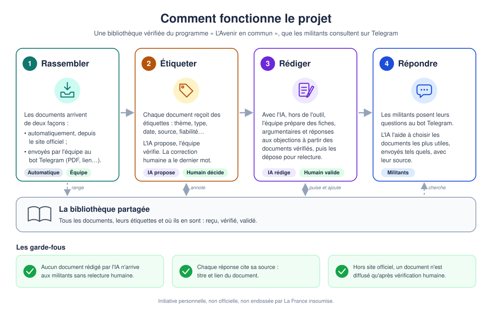
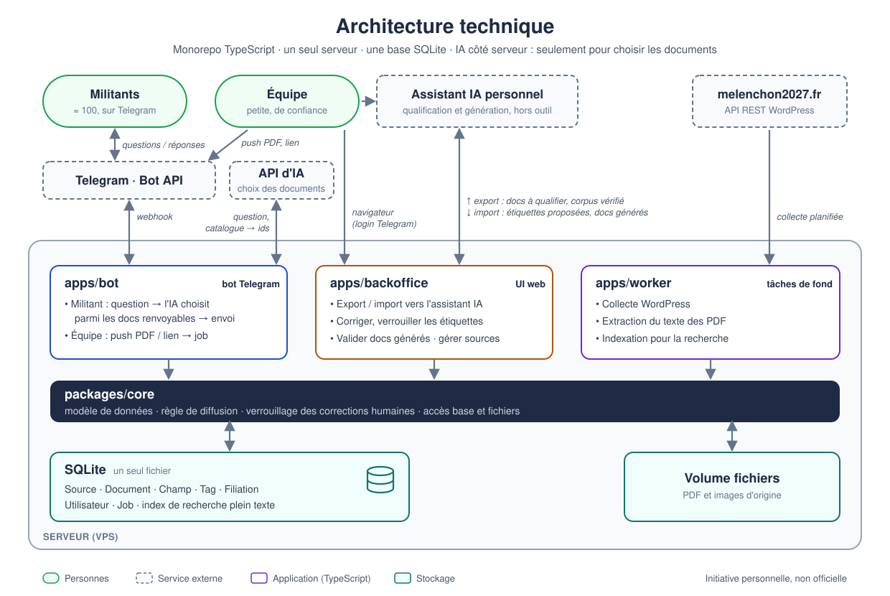

# Architecture cible — AECBot

> **Statut** : vision cible, rédigée en octobre 2026. Le code actuel (`pipeline/`, Python) ne couvre
> qu'une partie de l'étape 1 ; il sert de point de départ et de référence pendant le portage en
> TypeScript.
>
> **Cadre** : initiative personnelle, **non officielle**, non endossée par La France insoumise. Le bot
> doit l'indiquer clairement aux militants.



## En deux minutes (pour tout le monde)

Le projet est une **bibliothèque vérifiée** autour du programme « L'Avenir en commun », que les
militants interrogent depuis Telegram, l'outil qu'ils utilisent déjà.

1. **Rassembler** : les documents arrivent automatiquement depuis le site officiel, ou sont envoyés
   par l'équipe au bot Telegram (un PDF, un lien, un texte).
2. **Étiqueter** : chaque document reçoit des étiquettes (thème, type, date, source…). L'IA propose,
   un membre de l'équipe vérifie et corrige. La correction humaine a toujours le dernier mot.
3. **Rédiger** : hors de l'outil, avec l'IA, l'équipe prépare des fiches thématiques, des
   argumentaires et des réponses aux objections à partir des documents vérifiés. Elle les dépose
   ensuite dans l'outil, où un membre de l'équipe les relit et les valide.
4. **Répondre** : un militant pose une question au bot. L'IA aide le bot à choisir les documents les
   plus utiles, que le bot envoie tels quels, toujours avec leur source. L'IA ne rédige pas la
   réponse.

Trois garde-fous :
- aucun document rédigé par l'IA n'arrive à un militant sans relecture humaine (seul le court
  résumé d'un document écrit par des humains peut être proposé par l'IA et affiché tel quel) ;
- chaque réponse cite sa source (titre et lien) ;
- un document qui ne vient pas d'une source officielle n'est diffusé qu'après vérification humaine.

---

## Principes de conception

| Principe | Conséquence |
|---|---|
| **Un seul modèle de document** | Documents collectés et documents générés vivent dans la même base. « Corpus qualifié » et « corpus publiable » sont des filtres, pas deux systèmes. |
| **L'humain a le dernier mot** | Chaque champ sait qui l'a rempli (IA ou humain). Une correction humaine est verrouillée : l'IA ne l'écrase jamais, même en relançant la qualification. |
| **La confiance vient de la source** | Une source `officielle` (WordPress LFI) peut être diffusée après qualification par l'IA seule. Les autres sources exigent une vérification humaine. |
| **L'IA d'AECBot choisit, elle ne rédige pas** | La qualification et la génération par IA se font hors de l'outil, avec un assistant IA personnel : AECBot exporte la matière (documents à qualifier, corpus vérifié) et importe le résultat (étiquettes proposées, documents générés), qui passe ensuite par la validation humaine. Le **seul** appel IA côté serveur est la recherche du bot : le modèle reçoit la question et des documents candidats, et ne renvoie que des identifiants. Le message envoyé au militant est composé uniquement de champs stockés, jamais de texte écrit par l'IA à la volée. |
| **Agnostique du fournisseur d'IA** | Aucun fournisseur ni modèle n'est imposé. Côté serveur, l'appel IA passe par une interface de `packages/core`, avec un fournisseur choisi par configuration. Hors outil, les formats d'export et d'import sont ouverts (Markdown, JSON) et utilisables avec n'importe quel assistant IA. |
| **Traçabilité** | Tout document généré liste les documents sources sur lesquels il s'appuie. Toute réponse du bot cite sa source. |
| **Au plus simple** | Un serveur, des fichiers Markdown versionnés dans git en phase 1, puis un fichier SQLite. Pas de Redis, pas de file de messages, pas de base vectorielle tant que ce n'est pas nécessaire. |
| **Full TypeScript** | Un monorepo, un modèle partagé entre bot, back-office et worker. |

## Modèle de données

```
Source        id, nom, url, confiance (officielle | vérifiée | non_vérifiée)

Document      id, origine (wp | push | généré), source_id, titre,
              résumé (quelques lignes, pas le contenu), fichier (chemin, optionnel),
              statut, créé_le, créé_par

Champ         document_id, clé, valeur,
              auteur (ia | humain), auteur_id, verrouillé, maj_le

Tag           document_id, tag, auteur (ia | humain)          -- tags libres

Filiation     document_généré_id → document_source_id         -- sources d'un doc généré

Utilisateur   telegram_id, nom, rôle (équipe | admin)          -- l'équipe uniquement

Job           id, type, payload, statut, tentatives, erreur   -- file de travail du worker
```

Ce modèle relationnel est la cible à partir de la phase 2 (back-office, éditions concurrentes).

### Phase 1 : un fichier Markdown par document

Tant que le bot ne fait que lire, le corpus est un dossier de fichiers Markdown versionné dans git :
un fichier par document, avec les métadonnées dans un en-tête YAML et un **résumé de quelques
lignes** dans le corps. **Le contenu du document n'est pas stocké** : il reste à la source, que
l'URL permet d'ouvrir. git sert d'historique et de sauvegarde. Au
démarrage, le bot charge tout le dossier et construit un index de recherche en mémoire. Le schéma
qui fait référence, et le message d'erreur en cas de fichier invalide, sont dans
[`packages/core/src/catalogue/format-markdown.ts`](../packages/core/src/catalogue/format-markdown.ts).

```markdown
---
id: wp-12364
titre: Livret « Écologie »
url: https://melenchon2027.fr/wp-content/uploads/2024/02/Livret_UP_07_ECOLOGIE_web-ok.pdf
origine: wp                 # wp | push | genere
statut: qualifie_ia         # recu | qualifie_ia | qualifie | brouillon | valide | rejete
source:
  nom: melenchon2027.fr
  confiance: officielle     # officielle | verifiee | non_verifiee
type_media: pdf             # pdf | page | texte | image
date_publication: "2024-02-02"   # facultatif tant que la vraie date est inconnue
corpus: aec_2022            # aec_2027 | aec_2022 | nfp_2024 | autre
validite: en_vigueur        # en_vigueur | remplace | archive
themes: [ecologie]
tags: [regle verte, planification]
verrouilles: [themes, resume]   # champs relus par un humain : l'IA n'y touche plus
---

Le livret détaille la planification écologique et la règle verte : aucune activité ne doit
prélever sur la nature plus qu'elle ne peut reconstituer.
```

- Le corps est le résumé, limité à 1 500 caractères : un fichier qui contiendrait le document
  entier est refusé au chargement.
- La recherche porte sur le titre, le résumé, les thèmes et les tags. La citation se fait par titre
  et lien, sans numéro de page.
- `verrouilles` remplace, en phase 1, le suivi champ par champ de la table `Champ` : un champ
  listé a été relu par un humain. Pour `resume`, c'est aussi ce qui autorise à l'afficher au
  militant.
- Un fichier invalide ou un `id` en double est écarté au chargement et signalé, sans bloquer le
  reste du corpus.

### Statuts

```
Document collecté :  reçu ──► qualifié_ia ──► qualifié (relu par un humain)
Document généré   :  déposé (brouillon) ──► validé
                               └─► rejeté
```

### Properties obligatoires

| Clé | Valeurs | Pourquoi |
|---|---|---|
| `type_media` | `pdf`, `page`, `texte`, `image` (vidéo/audio plus tard) | Demandé : base de la classification. |
| `source` | référence vers une `Source` | Porte le niveau de confiance. |
| `url_origine` | URL, ou « push par <membre> » | Citation systématique. |
| `date_publication` | date | ≠ date de modification WordPress, qui n'est **pas** une date de rédaction ou d'adoption. |
| `corpus` | `aec_2027`, `aec_2022`, `nfp_2024`, `autre` | Ne jamais mélanger des programmes différents (le contrat NFP 2024 n'est pas l'AEC). |
| `validité` | `en_vigueur`, `remplacé`, `archive` | Le programme 2027 est provisoire : une nouvelle édition doit pouvoir déclasser l'ancienne. |
| `thèmes` | liste **fermée** (chapitres de l'AEC) | Colonne vertébrale de la recherche. Les tags libres viennent en plus. |

**Pour les documents générés uniquement** : `type_généré` (`fiche`, `argumentaire`,
`réponse_objection`), au moins une `Filiation`, `validé_par`, `validé_le`.

**Résumé** : quelques lignes, proposées par l'IA à la qualification. C'est le seul « contenu »
stocké. Le bot l'utilise toujours pour **choisir** les documents. Pour l'**afficher** au militant :
- document écrit par des humains (collecté) : le résumé proposé par l'IA peut être affiché sans
  relecture ;
- document généré : le résumé n'est affiché qu'une fois relu par un humain ; sinon, le militant
  reçoit seulement le titre et le lien.

La fonction qui fait référence est `apercu`, dans
[`packages/core/src/diffusion.ts`](../packages/core/src/diffusion.ts).

**Facultatives** : tags libres, `public` (`militant` / `grand_public`).

### Règle de diffusion

C'est la règle centrale du projet. Elle vit à un seul endroit, la fonction `estRenvoyable` de
[`packages/core/src/diffusion.ts`](../packages/core/src/diffusion.ts), et le bot ne contourne
jamais ce filtre. Le code fait référence ; ce tableau en donne la lecture.

| Document | Statut | Source officielle | Autre source |
|---|---|---|---|
| collecté | reçu (pas encore étiqueté) | non | non |
| collecté | qualifié par l'IA, pas relu | **oui** | non |
| collecté | qualifié (relu par un humain) | oui | oui |
| généré | brouillon ou rejeté | non | non |
| généré | validé par un humain | oui | oui |

## Composants



| Composant | Rôle |
|---|---|
| `packages/core` | Modèle de données (schéma Drizzle), règle `estRenvoyable`, règle de verrouillage des champs, accès DB. Importé par les trois apps. |
| `apps/worker` | Exécute les jobs : collecte WordPress, extraction de texte (PDF), indexation pour la recherche. Tourne en continu et dépile la table `Job`. N'appelle aucune IA. |
| `apps/backoffice` | UI web de l'équipe : export des documents à qualifier et du corpus vérifié, import des étiquettes proposées et des documents générés, édition et verrouillage des champs et tags, relecture et validation des documents générés, gestion des sources. Login via « Login with Telegram ». |
| `apps/bot` | Bot Telegram. Militants : question → présélection en base → choix par l'IA → documents renvoyables, avec source et avertissement « initiative non officielle ». Seul composant qui appelle une IA. Équipe (identifiée par `telegram_id`) : envoi d'un PDF ou d'un lien → document `reçu` + job d'extraction. |

## Flux principaux

**Collecte WordPress** (job planifié) : appel API `/pages`, `/posts`, `/media` → comparaison par
`id` + date de modification (logique actuelle de `check_updates.py`) → nouveaux documents `reçu`,
source `officielle` → job d'extraction → file « à qualifier ».

**Push par l'équipe** : un membre envoie un fichier ou un lien au bot → document `reçu`, source
choisie ou `non_vérifiée` par défaut → même extraction, puis file « à qualifier ».

**Qualification (IA hors AECBot)** :
1. Le back-office exporte les documents `reçu` (`id`, titre, source, URL et texte extrait). Le
   texte extrait sert seulement à cette qualification : il n'est jamais stocké dans le corpus.
2. Avec son assistant IA personnel (et un prompt de qualification fourni par AECBot), un membre
   fait proposer le résumé, les properties obligatoires, les thèmes et des tags libres, dans un
   format JSON défini par AECBot (un objet par
   `id`).
3. Il importe ce fichier dans le back-office. AECBot le valide contre le schéma de
   `packages/core` et enregistre chaque valeur avec `auteur = ia`, non verrouillée →
   `qualifié_ia`.
4. Un humain relit ; chaque champ qu'il touche devient `auteur = humain, verrouillé = true` →
   `qualifié`. Un nouvel import ne modifie que les champs non verrouillés.

**Génération (hors AECBot)** :
1. Le back-office exporte le corpus vérifié (documents renvoyables, avec leur `id`, titre, URL et
   résumé), dans un format ouvert (Markdown + manifeste JSON), successeur des exports actuels
   `artifacts/gpt/` et `artifacts/skills/`.
2. Avec son assistant IA personnel, un membre rédige une fiche, un argumentaire ou une réponse à
   une objection, en citant les `id` des documents utilisés.
3. Il dépose le résultat dans le back-office (ou l'envoie au bot) → document `origine = généré`,
   statut `déposé (brouillon)`, `Filiation` construite à partir des `id` cités → relecture →
   `validé` ou `rejeté`.

Comme pour la qualification, AECBot ne fait aucun appel IA et ne paie pas cette partie.

**Question d'un militant** (seul usage de l'IA côté serveur), implémenté par `choisirDocuments`
([`packages/core/src/recherche/`](../packages/core/src/recherche/)) :
1. **Comprendre** : l'IA reçoit la question et la liste fermée des thèmes. Elle renvoie, en sortie
   structurée, des thèmes et des mots-clés, ce qui couvre les questions formulées avec d'autres mots
   que ceux des documents.
2. **Présélectionner** (sans IA) : recherche de ces mots-clés dans les titres, résumés, thèmes et
   tags (index MiniSearch en mémoire en phase 1, FTS5 avec SQLite ensuite), plus les
   documents des thèmes, filtrés par `estRenvoyable` et `validité = en_vigueur` → 20 à 30
   candidats, avec titre et résumé.
3. **Choisir** : l'IA classe les candidats et renvoie 3 à 5 `id`. Tout `id` absent de la liste des
   candidats est ignoré, ce qui rend le filtre de diffusion impossible à contourner.
4. **Répondre** (sans IA) : le bot compose le message à partir des champs stockés uniquement
   (titre, lien, et résumé selon la règle `apercu`) et ajoute l'avertissement « initiative non
   officielle ».

Si l'API d'IA est indisponible, le bot se rabat sur la recherche plein texte seule (étape 2 sur la
question brute). La question est transmise au fournisseur d'IA **sans** identifiant Telegram.

Il n'y a pas de RAG (une réponse rédigée par l'IA à partir des documents) : ce serait du texte IA
non relu envoyé au militant, ce que la règle de diffusion interdit.

## Stack technique

| Besoin | Choix | Note |
|---|---|---|
| Langage / runtime | TypeScript, Node.js LTS, monorepo en workspaces npm | Tests : Vitest. Validation des réponses de l'IA : zod. |
| Stockage (phase 1) | fichiers Markdown + en-tête YAML, dans git | Recherche : index MiniSearch en mémoire, reconstruit au démarrage (quelques ms par requête sur le corpus actuel). |
| Base de données (phase 2) | SQLite via `better-sqlite3` + Drizzle ORM | FTS5 pour la recherche ; `sqlite-vec` si on ajoute la recherche sémantique. Remplace le `Catalogue` Markdown sans toucher à `choisirDocuments`. |
| File de jobs | table `Job` dans SQLite | Suffisant à ce volume. |
| Bot Telegram | grammY | |
| Back-office | à trancher en phase 2 (proposition : React + Vite, API Hono) | Login with Telegram. |
| Extraction PDF | `mupdf` (bindings officiels WASM/JS de MuPDF) | Même moteur que PyMuPDF aujourd'hui. Licence **AGPL**, comme PyMuPDF. |
| IA côté serveur | fournisseur à choisir, petit modèle rapide avec sorties structurées (JSON) | Uniquement pour la recherche du bot : comprendre la question, choisir parmi les candidats. Derrière une interface de `packages/core`, avec un fournisseur configurable. |
| IA hors outil | assistant IA personnel, au choix | Qualification et génération. AECBot fournit les prompts et définit les formats d'export et d'import (schémas dans `packages/core`). |
| Hébergement | un petit VPS, Docker Compose, Caddy (HTTPS) | On part de zéro. |

**Volume attendu** pour la première cible : environ 100 militants × 20 questions/semaine, soit
~2 000 questions/semaine (~300/jour), soit environ 600 petits appels IA par jour (deux par
question, sur un petit modèle). Le coût est à mesurer sur des requêtes réelles dès la phase 1.

## Organisation du repo

Ce repo évolue vers un monorepo. Le pipeline Python reste en place comme référence jusqu'à ce que
son équivalent TypeScript soit vérifié, puis il est supprimé.

```
aecbot/
├─ packages/core/       modèle, règles, accès DB
├─ apps/worker/
├─ apps/backoffice/
├─ apps/bot/
├─ pipeline/            (Python actuel — référence, supprimé après portage)
├─ data/, artifacts/    corpus actuel — importé dans la base en phase 1
└─ docs/                ce document + schéma
```

Les exports actuels (`artifacts/gpt/` pour un Custom GPT, `artifacts/skills/avenir-en-commun/` pour un skill Claude) deviennent
l'export du corpus vérifié produit depuis la base (phase 3), qui alimente la génération hors outil.

## Feuille de route

1. **Socle** : `packages/core` + corpus en fichiers Markdown, portage de la collecte WordPress et de
   l'extraction PDF, import du corpus actuel (la classification heuristique de `build_corpus.py`
   sert de qualification initiale, les PDF en double sont écartés, et une première qualification
   produit les résumés), bot
   avec présélection plein texte et choix par l'IA. *À la fin de cette
   phase, les militants ont déjà un outil utile.*
2. **Qualification** : passage du corpus Markdown à SQLite, export des documents à qualifier,
   prompt de qualification, import des étiquettes proposées, back-office (correction, verrouillage, gestion des sources), login
   Telegram, push de documents via le bot.
3. **Documents générés** : export du corpus vérifié pour l'assistant IA, dépôt des fiches,
   argumentaires et réponses aux objections rédigés hors outil, relecture et validation dans le
   back-office.
4. **Recherche sémantique** (optionnel) : si la présélection plein texte rate trop de documents
   pertinents, ajouter des embeddings (`sqlite-vec`) pour la présélection.

## Hors périmètre pour l'instant

- Vidéo et audio (nécessitent une transcription).
- Push proactif vers les militants (canal, abonnements par thème).
- Validation à plusieurs relecteurs.
- Invalidation automatique d'un document généré quand une de ses sources change.

## Questions ouvertes

- **Données personnelles** : un historique « tel militant a posé telle question sur un programme
  politique » relève des données sensibles au sens du RGPD (opinions politiques). Proposition : ne
  pas stocker l'identifiant Telegram avec les questions, ou seulement sous forme pseudonymisée, et
  limiter la durée de conservation.
- **Documents poussés sans URL publique** (PDF envoyé au bot) : le contenu n'étant pas stocké dans
  le corpus, où vit le fichier d'origine, et quel lien le bot donne-t-il au militant ?
- **Liste fermée des thèmes** : partir des chapitres de l'AEC 2027 ? Qui la fait évoluer ?
- **Sources `vérifiées`** : quelles sources, au-delà du site officiel, l'équipe juge-t-elle fiables ?
- **Archives** : le bot peut-il renvoyer un document `remplacé` ou `archive` si la question le
  demande explicitement (« que disait le programme 2022… ») ?
- **Sources d'un document déposé** : citer les `id` AECBot dans le texte généré (contrainte à
  ajouter au prompt de génération), ou les saisir à la main au dépôt ? La première option rend la `Filiation`
  automatique.
- **Coût de la recherche IA** : à chiffrer en phase 1 avec les tarifs en vigueur et des requêtes
  réelles. Deux appels par question, ou un seul (sauter l'étape « comprendre ») si la qualité suffit ?
